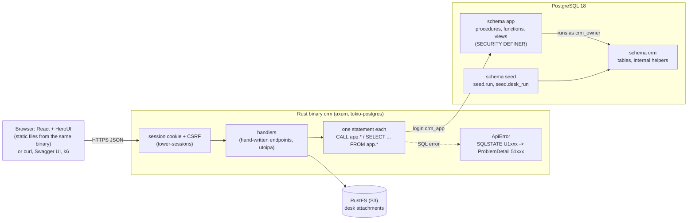
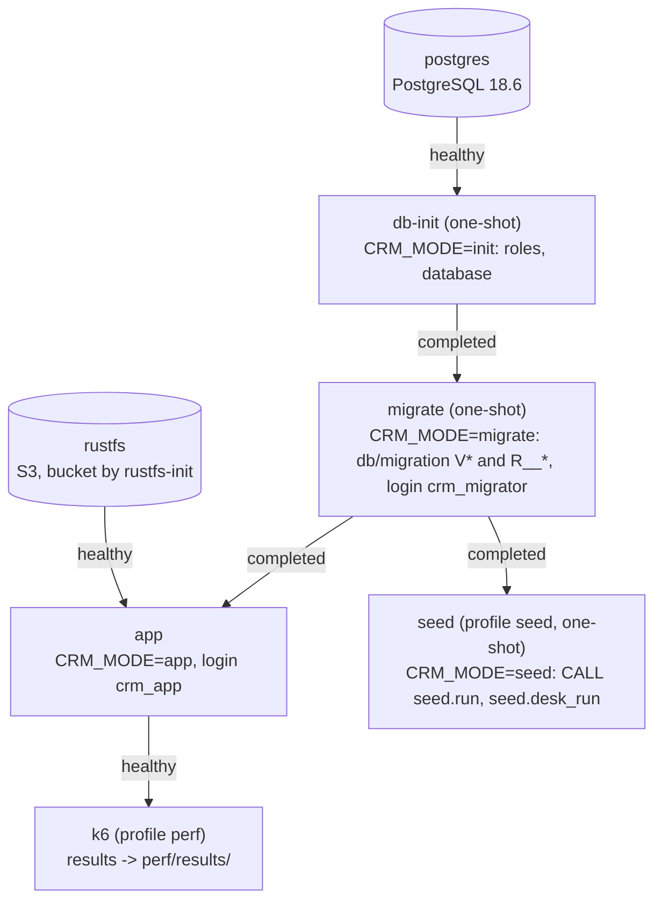
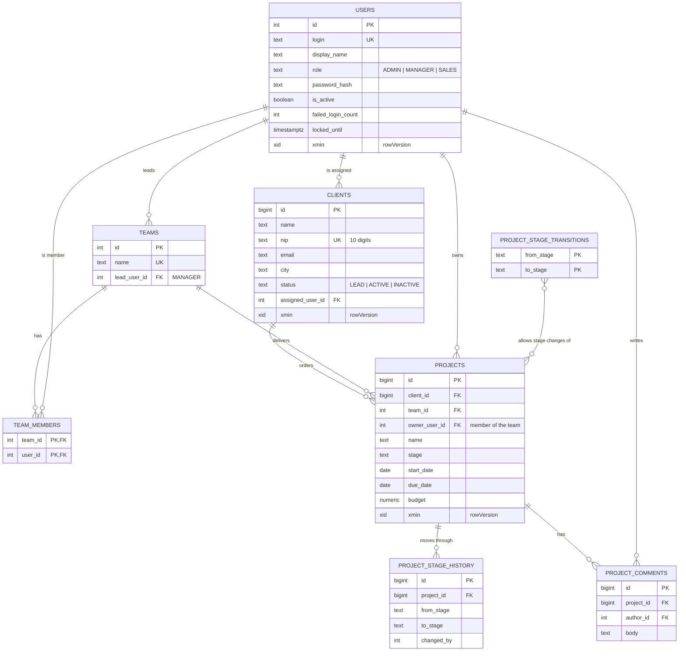
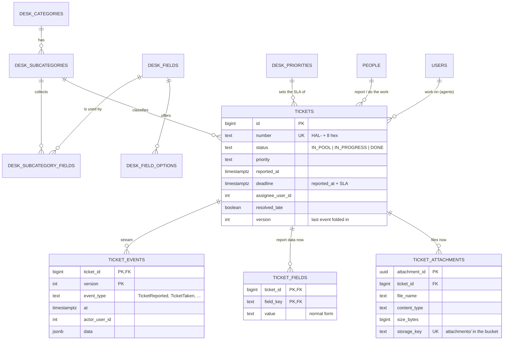
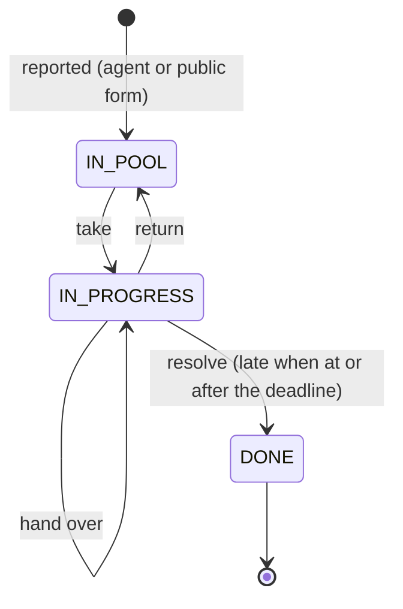
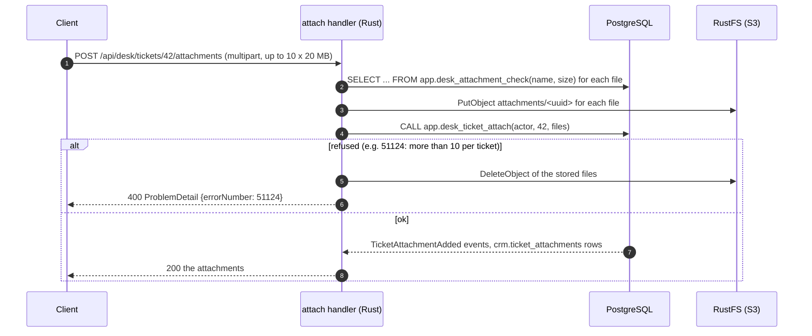
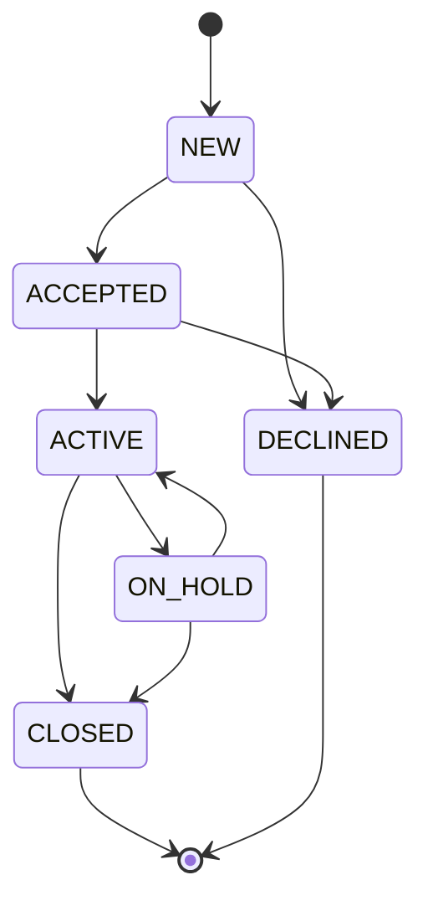
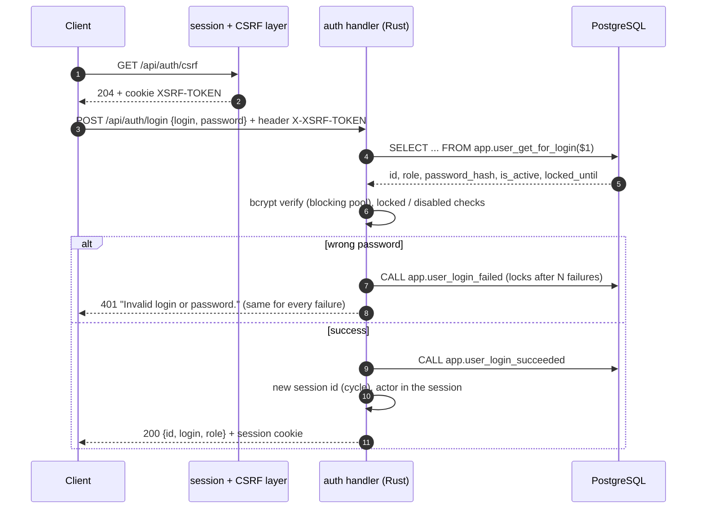
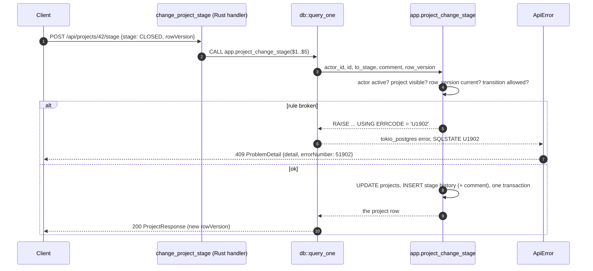
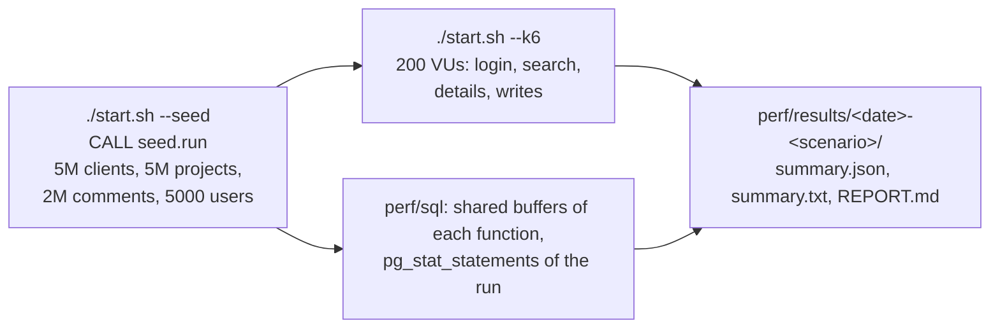

# Diagrams

## Architecture

The application never touches a table. Every endpoint is hand-written in Rust and calls one `CALL app.<procedure>`
or reads one `SELECT ... FROM app.<function|view>` with a login that has only `EXECUTE` / `SELECT` on schema `app`.

## Containers (docker compose)

## Data model

`rowVersion` is the row's `xmin`. Read model: `crm.team_project_stats` (count and budget per team and stage), kept
in step by the procedures that write projects (`crm.team_stats_move`) - PostgreSQL has no indexed views.

## Service desk

One event stream per ticket: every action appends one row to `crm.ticket_events` (version = the next number of the
ticket) and updates the read model `crm.tickets` in the same transaction; the ticket's row lock decides between two
agents acting at once (U1910 -> 51910 for the slower one). Report data and attachments are events too, with their
current state in `crm.ticket_fields` and `crm.ticket_attachments`; the files themselves are in S3.

An upload: `app.desk_attachment_check` checks every file before a byte is stored, the bytes go to the bucket, then
one procedure appends the events; when the database refuses, the stored objects are deleted again.

## Project stages

The allowed moves are rows of `crm.project_stage_transitions`; `app.project_change_stage` refuses anything else
with SQLSTATE U1902, answered as error 51902 (HTTP 409).

## Login

## A write with a business error

## Performance test

